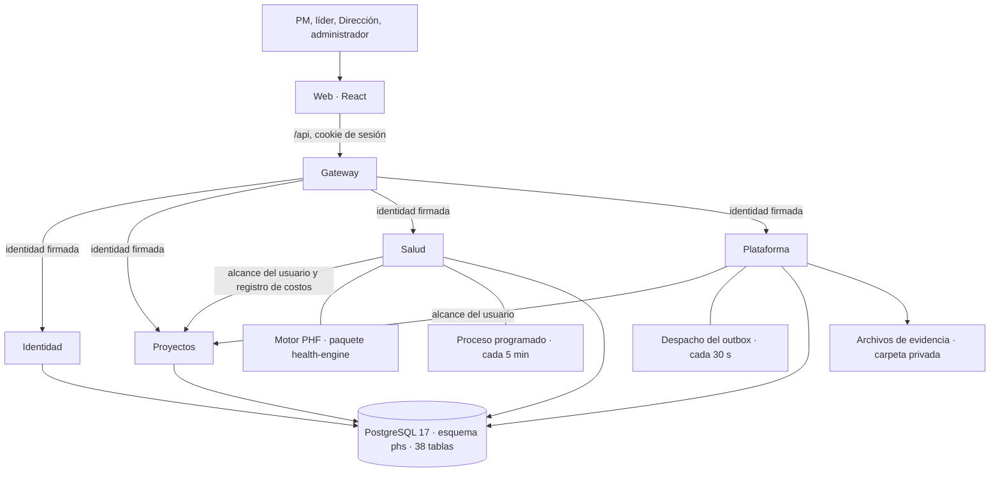
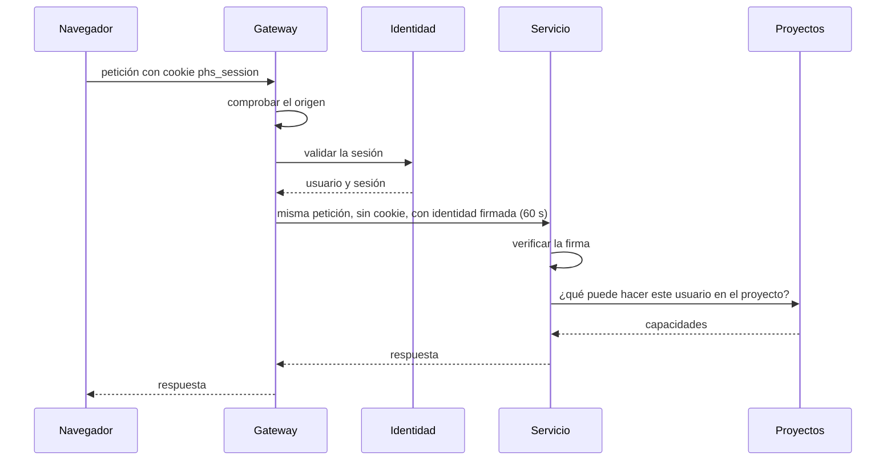
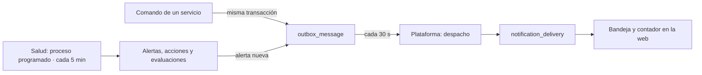

# Arquitectura vigente de PHS

Describe el sistema **como está construido** al 2026-10-12 (BIT-0042): qué componentes existen, qué hace cada uno, cómo se comunican y cómo se ejecutan y prueban. El inventario se tomó del código.

Todo lo que aquí aparece como construido está **en revisión**: ninguna entrega ha sido aceptada por el dueño del producto. Lo que le falta a cada historia está en su línea "Estado" del [backlog](producto/BACKLOG.md), y el porqué de cada decisión en los [ADR](adr/002-microservicios.md) y en [DECISIONES.md](producto/DECISIONES.md). El documento [ARQUITECTURA-PHS.md](ARQUITECTURA-PHS.md) es el diagnóstico y la propuesta inicial; se conserva como antecedente.

## 1. Vista general

PHS es una aplicación web para gobernar la salud de proyectos y servicios con el Project Health Framework (PHF). La forman una web, un gateway y cuatro servicios de negocio que comparten una base PostgreSQL.

Principios que se cumplen en el código:

- **Un solo punto de entrada.** El navegador solo conoce al gateway. Los servicios no se publican.
- **Un servicio escribe cada tabla.** Lo impone la base con un rol de PostgreSQL por servicio; todos pueden leer todas.
- **Base compartida.** Un solo esquema con todas sus claves foráneas; las migraciones son un único historial.
- **Historia inmutable.** Lo enviado o decidido no se modifica: se corrige con una fila nueva.
- **Todo cambio deja rastro.** Auditoría en la misma transacción que el cambio.

## 2. Componentes construidos

### 2.1 Aplicaciones

| Componente | Carpeta | Puerto local | Qué hace | Rutas |
| --- | --- | --- | --- | --- |
| Web | `apps/web` | 5173 | Interfaz de usuario. | — |
| Gateway | `apps/gateway` | 3000 | Sesión, verificación de origen, firma de identidad y enrutamiento. Sin reglas de negocio. | 78 públicas |
| Identidad | `apps/identity` | 3001 | Usuarios, contraseñas, sesiones, prácticas y roles. | 12 internas |
| Proyectos | `apps/projects` | 3002 | Proyectos y sus compromisos; decide quién puede ver y hacer qué en cada proyecto. | 35 internas |
| Salud | `apps/health` | 3003 | Motor PHF, revisiones, alertas, acciones y vistas de gobierno. | 24 internas |
| Plataforma | `apps/platform` | 3004 | Evidencias, historial y notificaciones. | 10 internas |

Los contratos de todas las rutas están en [docs/api](api/README.md), generados desde el código y verificados en cada cambio.

### 2.2 Gateway

| Módulo | Archivo | Función |
| --- | --- | --- |
| Sesión | `session.controller.ts`, `identity.client.ts` | Inicio y cierre de sesión, sesión actual y cambio de contraseña. Emite la cookie `phs_session`. |
| Autenticación | `authenticate.ts` | En cada petición valida la sesión contra Identidad, quita la cookie y añade la identidad firmada. |
| Seguridad HTTP | `http.ts` | Identificador de petición y rechazo de orígenes no permitidos (`WEB_ORIGIN`). |
| Enrutamiento | `routes.ts` | Prefijos públicos hacia cada servicio (tabla siguiente). |
| Estado | `status.controller.ts`, `status.service.ts` | `/api/v1/status`: salud de los cuatro servicios y de su conexión a la base. |

| Prefijo público | Servicio |
| --- | --- |
| `/api/v1/session`, `/api/v1/status` | Gateway |
| `/api/v1/admin` | Identidad |
| `/api/v1/projects`, `/catalog`, `/clients`, `/people`, `/reports` | Proyectos |
| `/api/v1/assessments`, `/api/v1/governance` | Salud |
| `/api/v1/evidence`, `/history`, `/notifications` | Plataforma |

### 2.3 Identidad

| Módulo | Archivo | Función | Historias |
| --- | --- | --- | --- |
| Acceso | `auth.service.ts`, `session.controller.ts`, `passwords.ts` | Verificación de contraseña (Argon2id), bloqueo por intentos, sesiones con vencimiento absoluto y por inactividad, cambio obligatorio de contraseña temporal. | PHS-005 |
| Administración | `admin.service.ts`, `admin.controller.ts`, `admin.guard.ts` | Usuarios, restablecimiento de contraseña, prácticas y roles por práctica. Solo administradores. | PHS-007 |
| Línea de comandos | `cli/create-user.ts`, `cli/seed-demo.ts` | Primer administrador y usuarios de demostración. | — |

Tablas que escribe: `app_user`, `user_credential`, `user_session`, `practice`, `practice_membership`.

### 2.4 Proyectos

| Módulo | Archivo | Función | Historias |
| --- | --- | --- | --- |
| Proyectos y alcance | `projects.service.ts`, `projects.controller.ts` | Alta, consulta con filtros y edición; aplica las reglas de alcance (D05) y responde a los demás servicios qué puede hacer un usuario en un proyecto. Reporte de pausados y cerrados. | PHS-006, 009, 046 |
| Equipo | `team.service.ts` | Integrantes y su dedicación. | PHS-010 |
| Hitos | `milestones.service.ts` | Registro, avance, cumplimiento, cancelación y reapertura. | PHS-015 |
| Riesgos | `risks.service.ts` | Registro y seguimiento. | PHS-016 |
| Economía | `finance.service.ts` | Observaciones de costo y esfuerzo, con correcciones que conservan la anterior. | PHS-012 |
| Línea base | `baselines.service.ts` | Publicación inicial y consulta de versiones. | PHS-011 |
| Cambios | `changes.service.ts` | Propuesta con impactos y decisión; aprobar publica una nueva línea base en la misma transacción. | PHS-018, 019 |
| Estado y renovaciones | `status.service.ts` | Pausa, cierre y reapertura con motivo, justificación a los 30 días (D08) y renovaciones. | PHS-013, 014 |
| Catálogo | `catalog.service.ts`, `catalog.controller.ts` | Tipos de servicio. | PHS-007 |

Tablas que escribe: `client`, `service_type`, `project`, `project_member`, `milestone`, `risk`, `renewal`, `financial_observation`, `project_change`, `change_decision`, `baseline`, `project_status_log`.

### 2.5 Salud

| Módulo | Archivo | Función | Historias |
| --- | --- | --- | --- |
| Evaluación | `assessments.service.ts`, `assessments.controller.ts` | Reúne los datos del proyecto, calcula con el motor y guarda la evaluación; tendencia y proyección; reglas vigentes. | PHS-025 a 029 |
| Revisiones | `review.service.ts`, `review.controller.ts`, `cadence.ts` | Política y calendario de ciclos, expectativas, borrador, envío del Health Review y validación del líder. | PHS-020 a 024 |
| Días festivos | `holiday.service.ts` | Calendario de días inhábiles que mantiene el administrador. | PHS-020 |
| Alertas y acciones | `governance.service.ts`, `governance.controller.ts` | Detección de condiciones, episodios, acciones automáticas y manuales, causa y plan con validación (D04). | PHS-030 a 032 |
| Proceso programado | `scheduler.service.ts` | Cada 5 minutos actualiza alertas, acciones y evaluaciones de todos los proyectos no cerrados; archiva su propio historial a los tres meses. | PHS-033 |
| Health Center | `center.service.ts` | Qué atender hoy según el papel del usuario en cada proyecto. | PHS-035, 036 |
| Portafolio | `portfolio.service.ts` | Indicadores y tabla de los proyectos del alcance, con las reglas de D10. | PHS-037 |
| Cliente de Proyectos | `projects.client.ts` | Pregunta el alcance del usuario y pide registrar costos. | — |

Tablas que escribe: `review_policy`, `review_cycle`, `review_draft`, `health_review`, `review_validation`, `holiday`, `rule_set`, `health_assessment`, `health_event`, `event_response`, `event_response_validation`, `health_task`, `scheduler_run`, `scheduler_run_daily`.

### 2.6 Plataforma

| Módulo | Archivo | Función | Historias |
| --- | --- | --- | --- |
| Evidencias | `evidence.service.ts`, `evidence.controller.ts`, `file-type.ts`, `storage.ts` | Texto y archivos de hitos, riesgos, cambios y revisiones; tipo detectado por contenido, límite de 10 MB, adenda y retiro con motivo (D09). | PHS-017 |
| Notificaciones | `notification.service.ts`, `notification.controller.ts` | Despacha el outbox cada 30 segundos y mantiene la bandeja de cada usuario. | PHS-033, 034 |
| Historial | `history.service.ts`, `history.controller.ts` | Historial paginado y línea de tiempo del proyecto. | PHS-038 |
| Cliente de Proyectos | `projects.client.ts` | Pregunta el alcance del usuario sobre un proyecto o elemento. | — |

Tablas que escribe: `evidence`, `evidence_withdrawal`, `notification_delivery`; marca como procesados los mensajes de `outbox_message`.

### 2.7 Tablas compartidas

Las inserta cualquier servicio dentro de la transacción de su propio cambio, y nadie las modifica: `audit_entry` (auditoría), `activity` (seguimiento de hitos, riesgos y acciones), `outbox_message` (mensajes para notificaciones) y `command_idempotency` (resultado de comandos, para que un reintento no se ejecute dos veces).

El detalle de las 38 tablas, sus columnas y el contenido de los catálogos está en el [diccionario de datos](DICCIONARIO-DATOS.md).

### 2.8 Paquetes compartidos

| Paquete | Carpeta | Contenido |
| --- | --- | --- |
| Contratos | `packages/contracts` | Esquemas de entrada y salida de cada ruta (Zod) y la generación de los documentos OpenAPI. Es la fuente de `docs/api`. |
| Motor PHF | `packages/health-engine` | Reglas versión 1 como funciones puras, sin base ni red: avance y desviaciones, seis dimensiones, topes por regla crítica, score, semáforo, confianza, tendencia, proyección y agregados de portafolio. |
| Utilidades de servicio | `packages/service-kit` | Configuración, conexión y transacciones, auditoría, outbox, idempotencia, reglas de alcance (D05) y firma y verificación de la identidad interna. |

### 2.9 Web

Una aplicación de una sola página. Cada sección del menú es un componente; las pestañas del proyecto, otro.

| Sección del menú | Componente | Contenido | Historias |
| --- | --- | --- | --- |
| Acceso | `App.tsx` | Inicio de sesión, cambio de contraseña obligatorio, menú lateral. | PHS-005 |
| Inicio | `Home.tsx` | Health Center: qué atender y estado de los proyectos. | PHS-035, 036 |
| Portafolio | `Insight.tsx` | Indicadores, filtros y tabla. | PHS-037 |
| Proyectos | `Projects.tsx` | Lista con filtros, alta y detalle con pestañas. | PHS-009 |
| Notificaciones | `Home.tsx` | Bandeja con contador de no leídas. | PHS-034 |
| Mis acciones | `Governance.tsx`, `Reviews.tsx` | Acciones a cargo del usuario y revisiones por validar. | PHS-024, 032 |
| Pausados y cerrados | `Insight.tsx` | Reporte con motivo y pendientes. | PHS-046 |
| Modelo PHF | `Insight.tsx`, `phf-catalog.json` | Flujo de once etapas, reglas vigentes y definiciones. | PHS-039 |
| Mis roles | `App.tsx` | Roles del usuario por práctica. | PHS-006 |
| Administración | `Admin.tsx` | Usuarios, prácticas, tipos de servicio y días festivos. | PHS-007 |

| Pestaña del proyecto | Componente | Historias |
| --- | --- | --- |
| Salud | `HealthView.tsx` | PHS-025 a 029 |
| Revisión | `Reviews.tsx` | PHS-020 a 024 |
| Alertas y acciones | `Governance.tsx` | PHS-030 a 032 |
| Historial | `Insight.tsx` | PHS-038 |
| Ficha, estado y renovaciones | `Projects.tsx`, `StatusRenewals.tsx` | PHS-009, 013, 014 |
| Equipo, hitos y línea base | `ProjectSections.tsx` | PHS-010, 011, 015 |
| Riesgos y economía | `RiskFinance.tsx` | PHS-012, 016 |
| Cambios | `Changes.tsx` | PHS-018, 019 |
| Evidencias (dentro de hitos, riesgos, cambios y revisiones) | `EvidencePanel.tsx` | PHS-017 |

`api.ts` concentra las llamadas al gateway y los textos de error; `ui.tsx` y `index.css`, el sistema de diseño ([DISENO-UI.md](producto/DISENO-UI.md)).

## 3. Cómo se comunican

### 3.1 Una petición del navegador

- **Sesión.** La cookie es `HttpOnly` y `SameSite=Strict`; solo la conoce el gateway. En la base se guarda la huella del token, no el token.
- **Identidad entre servicios.** La cabecera `x-phs-internal-auth` lleva usuario, sesión y petición firmados con HMAC-SHA256 y un secreto compartido (`INTERNAL_AUTH_SECRET`). Un servicio rechaza cualquier petición sin esa firma.
- **Permisos.** Las reglas de alcance (D05) viven en Proyectos. Salud y Plataforma no las repiten: reenvían la identidad firmada y preguntan. Lo que no existe y lo que el usuario no puede ver responden igual: 404.
- **Llamadas entre servicios.** Solo hay dos direcciones: Salud → Proyectos (alcance del usuario, lista de sus proyectos y registro de costo y esfuerzo al enviar una revisión) y Plataforma → Proyectos (alcance).

### 3.2 Garantías de los comandos

- **Idempotencia.** Los comandos que crean algo aceptan una clave `Idempotency-Key`: repetir la petición devuelve el resultado original.
- **Concurrencia.** Las ediciones envían la versión que el usuario veía (`expectedRevision`); si otra persona cambió el dato, se responde 409 con la versión vigente en lugar de pisar el cambio.
- **Auditoría.** Cada comando inserta su entrada de auditoría en la misma transacción.

### 3.3 Trabajo en segundo plano

- **Notificaciones.** Entrega al menos una vez; la clave única por mensaje, destinatario y canal impide duplicados. Un mensaje que falla se reintenta más tarde.
- **Proceso programado.** Cada pasada repite todo el trabajo, que es idempotente; un candado de PostgreSQL garantiza una sola pasada a la vez. Además, alertas y evaluación se actualizan al consultar un proyecto.

## 4. Tecnologías

| Capa | Tecnología |
| --- | --- |
| Lenguaje | TypeScript 6 sobre Node.js 24, módulos ES |
| Web | React 19, Vite 8, Tailwind CSS 4 |
| Servicios | NestJS 12, un proceso por servicio |
| Datos | PostgreSQL 17, driver `pg` con SQL parametrizado, sin ORM |
| Migraciones | SQL versionado con dbmate (`db/migrations`, 15 migraciones) |
| Validación y contratos | Zod 4, OpenAPI 3.1 generado |
| Cálculo | decimal.js para importes y scores |
| Contraseñas | Argon2id |
| Pruebas | Vitest, pruebas SQL con `psql`, Playwright |
| Paquetes | pnpm 12, monorepo con espacios de trabajo |

[STACK-TECNOLOGICO.md](STACK-TECNOLOGICO.md) es la propuesta inicial de tecnologías; esta tabla refleja lo que quedó en uso.

## 5. Cómo se ejecuta

| Modo | Comando | Para qué | Guía |
| --- | --- | --- | --- |
| Desarrollo local | `pnpm db:setup` y `pnpm dev` | Trabajar en el código, con PostgreSQL propio en `.local/pg` y sin Docker. | [README](../README.md) |
| Demostración en Docker | `sh scripts/docker-demo.sh` | Que alguien pruebe la aplicación completa sin instalar nada más que Docker. Un contenedor por proceso y nginx delante de la web. | [DOCKER.md](DOCKER.md) |
| Instalación desde cero | Paso a paso | Arrancar solo con el administrador y configurar la organización. | [MANUAL-AMBIENTACION-Y-PRUEBAS.md](MANUAL-AMBIENTACION-Y-PRUEBAS.md) |

La configuración es por variables de entorno ([.env.example](../.env.example)): conexión de cada servicio con su propio usuario de base, direcciones de los servicios, secreto interno, origen permitido de la web, carpeta de evidencias e intervalos de los procesos en segundo plano.

No existe todavía un entorno de piloto ni de producción.

## 6. Cómo se prueba

| Nivel | Qué cubre | Cantidad | Comando |
| --- | --- | --- | --- |
| Unitarias y de integración | Motor, utilidades, contratos y cada servicio contra PostgreSQL real | 165 pruebas en 8 paquetes | `pnpm test` |
| SQL | Restricciones, permisos por rol e inmutabilidad de cada migración | 15 archivos | `pnpm db:test` |
| De punta a punta por el gateway | Los cinco procesos reales sobre una base desechable | 13 escenarios | `pnpm test:e2e` |
| Navegador | Acceso por teclado, recorrido principal y vista móvil | 3 recorridos | `pnpm test:e2e` |
| Documentos generados | Contratos de API, diccionario de datos y matriz de pruebas al día | — | `pnpm test`, `pnpm db:dictionary -- --check`, `pnpm test:matrix` |

La integración continua ([.github/workflows/ci.yml](../.github/workflows/ci.yml)) ejecuta todo lo anterior en cada cambio y además construye y arranca las imágenes de Docker. La cobertura de los 18 escenarios de aceptación está en la [matriz de pruebas](pruebas/MATRIZ-PRUEBAS.md).

## 7. Estado y lo que falta

| Entrega | Contenido | Estado |
| --- | --- | --- |
| R1 | Acceso, permisos, administración, proyectos, equipo, hitos y línea base | Construida, en revisión |
| R2 | Economía, riesgos, evidencias, cambios, renovaciones, estado y motor de salud | Construida, en revisión |
| R3 | Ciclo de revisión, Health Review, alertas, acciones, confianza, tendencia, proyección y proceso programado | Construida, en revisión; PHS-031, 032 y 033 en parte |
| R4 | Notificaciones, Health Center, portafolio, historial, modelo PHF y pausados y cerrados | Construida, en revisión; PHS-038 y 039 en parte |
| R5 | Recorrido integral, usabilidad y accesibilidad, operación del piloto | PHS-040 en revisión; PHS-041 iniciada; PHS-042 sin empezar |

Límites de arquitectura conocidos:

- **Despliegue.** No hay entorno de piloto: faltan HTTPS, respaldos, restauración y monitoreo (PHS-042), y la decisión D07 sobre retención y respaldos.
- **Secreto interno.** Uno solo, compartido por todos los servicios y sin rotación definida.
- **Aislamiento de red.** En local los servicios escuchan solo en la propia máquina y en Docker no se publican; el aislamiento del despliegue real está por definir.
- **Identidad.** Usuarios y contraseñas en la propia base; la integración con un proveedor externo está pospuesta (D06).
- **Acoplamiento por la base.** Los servicios comparten esquema: una migración puede afectar a varios y el orden de despliegue importa. Es una limitación aceptada en ADR-002.
- **Una consulta a Identidad por petición**, sin caché; y el Health Center y el portafolio calculan la evaluación de cada proyecto al consultarse. No se ha medido con muchos proyectos.
- **Notificaciones** solo dentro de la aplicación; sin correo.
- **Navegador.** Solo tres recorridos automatizados; los formularios no tienen pruebas de pantalla.

## 8. Dónde está cada cosa

| Necesito saber… | Documento |
| --- | --- |
| Qué se decidió y por qué | [adr/001-stack-mvp.md](adr/001-stack-mvp.md), [adr/002-microservicios.md](adr/002-microservicios.md), [producto/DECISIONES.md](producto/DECISIONES.md) |
| Qué debe hacer el sistema | [producto/ESPECIFICACION.md](producto/ESPECIFICACION.md) |
| Qué historia cubre qué y cuánto le falta | [producto/BACKLOG.md](producto/BACKLOG.md) |
| Las reglas de cálculo de la salud | [producto/REGLAS-PHF-v1.md](producto/REGLAS-PHF-v1.md) |
| Las rutas y sus datos | [api/README.md](api/README.md) |
| Las tablas, columnas y catálogos | [DICCIONARIO-DATOS.md](DICCIONARIO-DATOS.md), [DATABASE-PHS.md](DATABASE-PHS.md) |
| Qué pantalla usa qué servicio y tablas | [MAPA-TRAZABILIDAD.md](MAPA-TRAZABILIDAD.md) |
| Qué se hizo en cada cambio | [BITACORA.md](BITACORA.md) |
| Cómo instalar y probar | [README](../README.md), [DOCKER.md](DOCKER.md), [MANUAL-AMBIENTACION-Y-PRUEBAS.md](MANUAL-AMBIENTACION-Y-PRUEBAS.md) |
